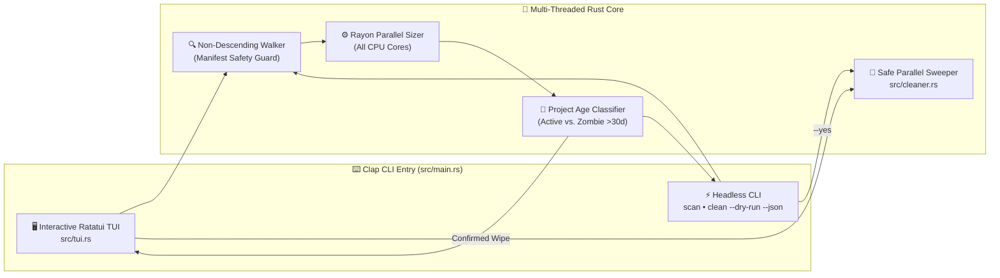

<a id="readme-top"></a>

<!-- CUSTOM 60FPS ANIMATED HERO BANNER -->
<div align="center">
  <a href="https://github.com/a1n2a3s6/disksweep/releases">
    
  </a>

  <br />
  <br />

  <!-- LIVE GITHUB STATS & DOWNLOAD BADGES -->
  <p>
    <a href="https://github.com/a1n2a3s6/disksweep/releases">
      
    </a>
    <a href="https://github.com/a1n2a3s6/disksweep/stargazers">
      
    </a>
    <a href="https://github.com/a1n2a3s6/disksweep/network/members">
      
    </a>
    
    
  </p>

  <!-- QUICK NAVIGATION -->
  <p>
    <a href="#-live-tui-preview"><strong>🎬 TUI Preview</strong></a> &nbsp;│&nbsp;
    <a href="#-supported-ecosystems"><strong>🧩 Ecosystems</strong></a> &nbsp;│&nbsp;
    <a href="#-bento-feature-suite"><strong>⚡ Features</strong></a> &nbsp;│&nbsp;
    <a href="#-architecture"><strong>🏗️ Architecture</strong></a> &nbsp;│&nbsp;
    <a href="#-download--cli-usage"><strong>📦 Install &amp; CLI</strong></a> &nbsp;│&nbsp;
    <a href="#-keybindings"><strong>⌨️ Keys</strong></a>
  </p>
</div>

---

> [!IMPORTANT]
> **Your SSD isn't full of photos — it's full of forgotten `node_modules`, Rust `target/`, Python `.venv/`, and `.next/` caches.**
> **DiskSweep** is a **~3 MB multi-threaded Rust binary** with a zero-lag `ratatui` Terminal UI that scans your entire projects folder in **under 0.5 seconds**, flags untouched **Zombie projects (>30 days old)**, and lets you safely reclaim **20–100+ GB** in two keystrokes across **Windows, Linux, and macOS**.

---

## 🎬 Live TUI Preview

<div align="center">
  
</div>

---

## 🧩 Supported Ecosystems

DiskSweep uses **sibling manifest verification** (e.g., only flagging `target/` when `Cargo.toml` exists, or `bin/`/`obj/` when `*.csproj` exists) so it **never** touches unrelated source folders:

| Ecosystem | Target Directories | Safety Verification |
| :--- | :--- | :--- |
| **JavaScript / TypeScript** | `node_modules`, `.turbo`, `.parcel-cache`, `dist` | Direct match / `package.json` |
| **Next.js / Nuxt / SvelteKit** | `.next`, `.nuxt`, `.svelte-kit` | Direct match |
| **Rust** | `target` | Verified sibling `Cargo.toml` |
| **Python** | `.venv`, `venv`, `__pycache__` | Direct match |
| **C# / .NET** | `bin`, `obj` | Verified sibling `*.csproj` |
| **Java / Kotlin / Android** | `.gradle`, `build` | Verified sibling `build.gradle*` |

---

## ⚡ Bento Feature Suite

<table>
  <tr>
    <td width="33%" valign="top">
      <h3>⚡ Rayon Parallel Rust Engine</h3>
      <p>Walks directory trees without double-counting nested artifacts and calculates exact byte sizes across all CPU cores in under 0.5 seconds.</p>
    </td>
    <td width="33%" valign="top">
      <h3>🧟 Zombie Age Guard</h3>
      <p>Calculates how many days ago each parent project was modified. Press <kbd>z</kbd> to auto-select only untouched <b>Zombie projects (&gt;30d)</b> while keeping active work untouched.</p>
    </td>
    <td width="33%" valign="top">
      <h3>🖥️ 0ms Ratatui Industrial TUI</h3>
      <p>Crisp Vim-navigable dashboard with proportional size bars, live ecosystem badges, instant <kbd>/</kbd> fuzzy filtering, and a live <b>Reclaimed GB</b> counter.</p>
    </td>
  </tr>
  <tr>
    <td width="33%" valign="top">
      <h3>🛡️ Built-In Safety Rails</h3>
      <p>Hard-coded protection refuses root/home deletions, skips OS system paths, and requires an explicit <code>y/n</code> confirmation showing exact GB to wipe.</p>
    </td>
    <td width="33%" valign="top">
      <h3>🤖 Scriptable CLI &amp; JSON Mode</h3>
      <p>Run headless audits in CI or cron jobs via <code>disksweep scan --older-than 30d --json</code> or preview wipes with <code>--dry-run</code>.</p>
    </td>
    <td width="33%" valign="top">
      <h3>📦 Tiny ~3 MB Native Binary</h3>
      <p>Compiled with LTO and symbol stripping into a single zero-dependency executable for <b>Windows</b>, <b>Linux</b>, and <b>macOS</b>.</p>
    </td>
  </tr>
</table>

---

## 🏗️ Architecture



<details>
<summary><b>📂 Inspect Full Rust Crate Structure</b></summary>

```text
disksweep/
├── .github/
│   └── workflows/
│       └── release.yml         # Automated ~3MB Windows, Linux & macOS release builds
├── assets/
│   ├── hero.svg                # Custom 60fps animated hero banner
│   └── sweep-demo.svg          # Live animated Ratatui TUI preview
├── src/
│   ├── main.rs                 # Clap CLI & TUI entry point
│   ├── models.rs               # ArtifactKind, ArtifactEntry & ScanStats
│   ├── scanner.rs              # Rayon parallel walker & manifest verifier
│   ├── cleaner.rs              # Guarded parallel directory sweeper
│   └── tui.rs                  # Zero-lag Ratatui industrial dashboard
├── Cargo.toml                  # LTO + stripped release profile
└── README.md
```

</details>

---

## 📦 Download & CLI Usage

### Option 1: Pre-Built Native Binary (~3 MB, Zero Install)
Download directly from **[GitHub Releases](https://github.com/a1n2a3s6/disksweep/releases)**:
- **Windows:** `disksweep-windows-x64.exe`
- **Linux:** `disksweep-linux-x64` (`chmod +x disksweep-linux-x64 && sudo mv disksweep-linux-x64 /usr/local/bin/disksweep`)
- **macOS (Apple Silicon):** `disksweep-macos-arm64`

### Option 2: Power CLI Examples
```bash
# Launch interactive TUI on your Projects folder
disksweep ~/Projects

# Headless audit of all dev artifacts untouched for 30+ days
disksweep scan ~/Projects --older-than 30

# Export scan results as JSON for automation
disksweep scan ~/Projects --json

# Preview a batch cleanup safely (zero files deleted)
disksweep clean ~/Projects --older-than 60 --dry-run
```

### Option 3: Build From Source (Rust)
```bash
git clone [https://github.com/a1n2a3s6/disksweep.git](https://github.com/a1n2a3s6/disksweep.git)
cd disksweep
cargo build --release
```

---

## ⌨️ Keybindings

| Key | Action |
| :---: | :--- |
| <kbd>j</kbd> / <kbd>k</kbd> or <kbd>↑</kbd> / <kbd>↓</kbd> | Navigate discovered artifacts |
| <kbd>Space</kbd> | Toggle selection on current directory |
| <kbd>z</kbd> | **Auto-Select All Zombies** (untouched for 30+ days) |
| <kbd>a</kbd> | Select / deselect all visible items |
| <kbd>s</kbd> | Cycle sort order (`Size` → `Age` → `Name`) |
| <kbd>/</kbd> | Instant fuzzy filter (by name, path, or ecosystem) |
| <kbd>d</kbd> | Sweep selected directories (with `y/n` confirmation) |
| <kbd>r</kbd> | Rescan directory tree |
| <kbd>q</kbd> | Quit DiskSweep |

---

## 📄 License

Distributed under the **MIT License**. Free to use, fork, and ship.

---

<div align="center">

<h3>👨‍💻 Engineered by Anas Alhelaly</h3>
<p><em>Day 14 (Week 2 Finale) of my <strong>365 Projects in 365 Days</strong> GitHub Challenge</em></p>

<p>
  <a href="https://anas-alhelaly.vercel.app/">
    
  </a>
  <a href="https://github.com/a1n2a3s6">
    
  </a>
  <a href="https://www.instagram.com/anas.alhelaly/">
    
  </a>
</p>

<p>⭐ <strong>If DiskSweep just freed up 20GB+ on your SSD, drop a Star on the repo!</strong> ⭐</p>

<p><a href="#readme-top"><strong>⬆️ Back to Top</strong></a></p>

</div>
